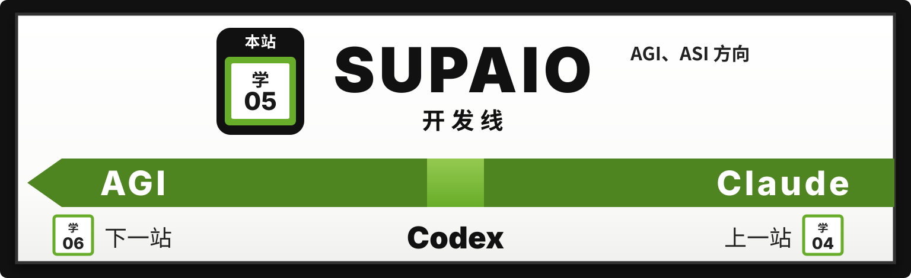
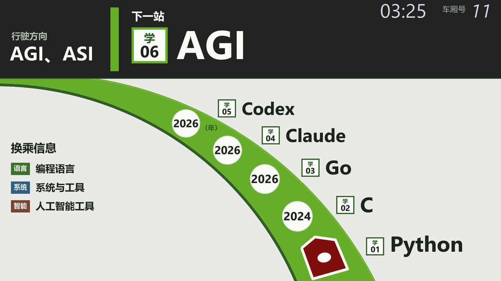

<!--
  Supaio · GitHub 个人主页
  JR 车站主题——山手线黄绿
-->

  
   

  

   

  
  &nbsp;&nbsp;
  

   
  我是Supaio，Supa国Supa州Supa市人，性别Supai。 
  我从 Python 入门，陆续学习 C 和 Go，现在也在探索如何用 Claude 和 Codex 辅助开发。

## 开发路线

  

## 项目与协作

<table width="100%">
  <tr>
    <td width="50%" valign="top">
      <a href="https://github.com/Supaio/UsagePeek"><strong>UsagePeek</strong></a> 
      在 Windows 托盘查看 Codex、Claude Code 和 Antigravity 的用量。
    </td>
    <td width="50%" valign="top">
      <a href="https://github.com/Supaio/LightweightCountdown"><strong>轻量倒计时</strong></a> 
      在 Windows 桌面同时显示多个倒计时，支持按月重复。
    </td>
  </tr>
  <tr>
    <td width="50%" valign="top">
      <a href="https://github.com/Supaio/chatgpt-windows-no-window-repair"><strong>ChatGPT / Codex 窗口修复</strong></a> 
      修复 Windows 版 ChatGPT 或 Codex 更新后窗口不显示的问题。
    </td>
    <td width="50%" valign="top">
      <a href="https://github.com/qiransy/managing-zotero-skill"><strong>Zotero 文献管理技能</strong></a> 
      我参与的开源项目，用 Codex 检索、去重和整理 Zotero 文献。
    </td>
  </tr>
</table>
